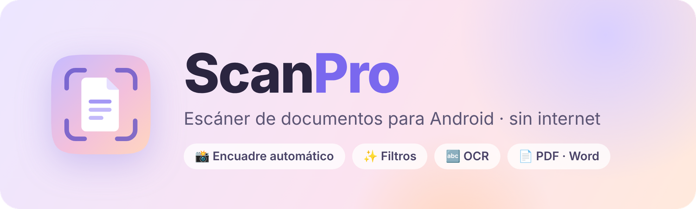

<!--IDIOMAS-->

<a href="README.md">🇪🇸 Español</a> · <a href="README.en.md">🇬🇧 English</a> · <a href="README.pt.md">🇧🇷 Português</a> · <a href="README.fr.md">🇫🇷 Français</a> · <a href="README.de.md">🇩🇪 Deutsch</a> · <a href="README.it.md">🇮🇹 Italiano</a> · <a href="README.zh.md">🇨🇳 中文</a> · <a href="README.hi.md">🇮🇳 हिन्दी</a> · <a href="README.id.md">🇮🇩 Indonesia</a> · <a href="README.ru.md">🇷🇺 Русский</a> · <a href="README.tr.md">🇹🇷 Türkçe</a> · <a href="README.vi.md">🇻🇳 Tiếng Việt</a> · <a href="README.ja.md">🇯🇵 日本語</a> · <a href="README.ko.md">🇰🇷 한국어</a> · <a href="README.ar.md">🇸🇦 العربية</a>

<!--/IDIOMAS-->

### Бумага — в чёткий PDF за секунды 📄✨

**Сделайте фото · ScanPro найдёт лист, выпрямит его и сделает как скан.**

<!--PROX-->

## 🚀 Скоро: ScanPro 1.4.0

**Сейчас бета.** Версия 1.4.0 будет опубликована здесь автоматически **8 ноября 2026 года** и скоро появится в **Google Play**.

<!--/PROX-->

## 🌸 Что умеет

- 📷 **Сканер Google с ИИ**: лучше фокус и поиск краёв, без интернета
- 🌍 **15 языков** с настройками для каждой страны (даты, валюта, бумага, документы)
- 📄 **Инструменты PDF**: разделить, сжать, пароль, водяной знак, нумерация
- ✍️ **Подпись**, текст, выделение, скрытие данных и штамп
- 🔤 **Распознавание текста (OCR)**, перевод, чтение вслух и диктовка
- 🧠 **Вопросы к документам**, проверка договоров и заполнение форм
- 🗂️ **Папки жизни** с напоминаниями о сроках, расходы и учёт товаров
- 🎓 Конспекты и карточки, PowerPoint и Word
- 📥 Открывает PDF, Word, Excel, PowerPoint, EPUB, ZIP, HEIC, TIFF и другие
- 👋 Экран приветствия, пошаговые подсказки, звуки и вибрация

## ⬇️ Установка

1. Откройте **[Releases](../../releases/latest)** и скачайте **APK**.
2. Откройте его на телефоне.
3. Если Android попросит, разрешите **«Установку неизвестных приложений»**.
4. Готово! Откройте **ScanPro** и выберите язык 👋

## 🔒 Конфиденциальность

- 📴 **Работает без интернета**
- 🏠 Фото и документы **никогда не покидают телефон**
- 🙅 **Без аккаунтов и аналитики**; иногда короткая реклама при экспорте
- 📷 Камера включается только по кнопке **«Сделать фото»**

**ScanPro** · сделано с 💜 в Колумбии

<!--LISTO

## 🎉 ScanPro 1.4.0 уже здесь!

LISTO-->
